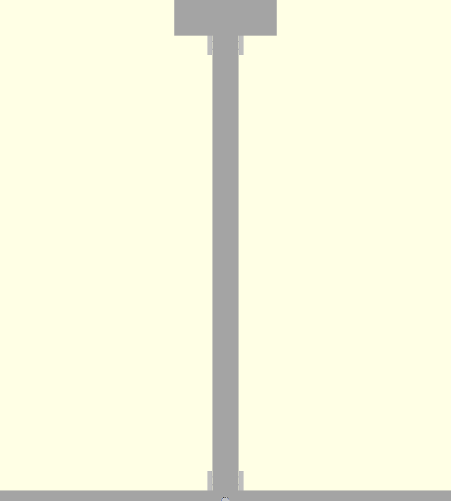
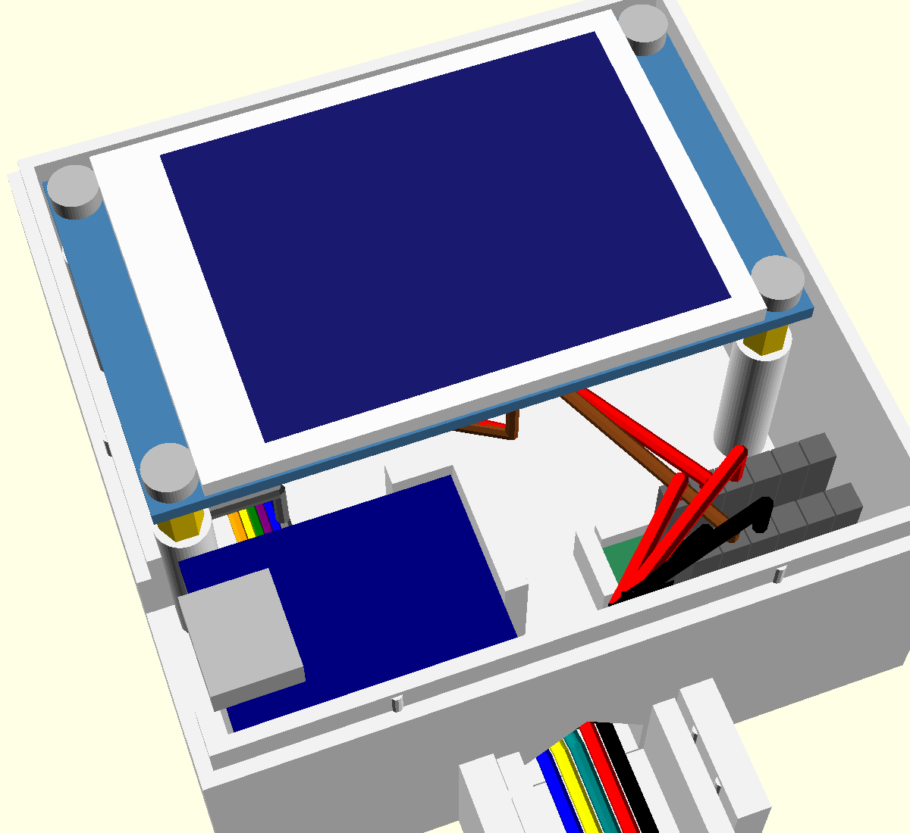
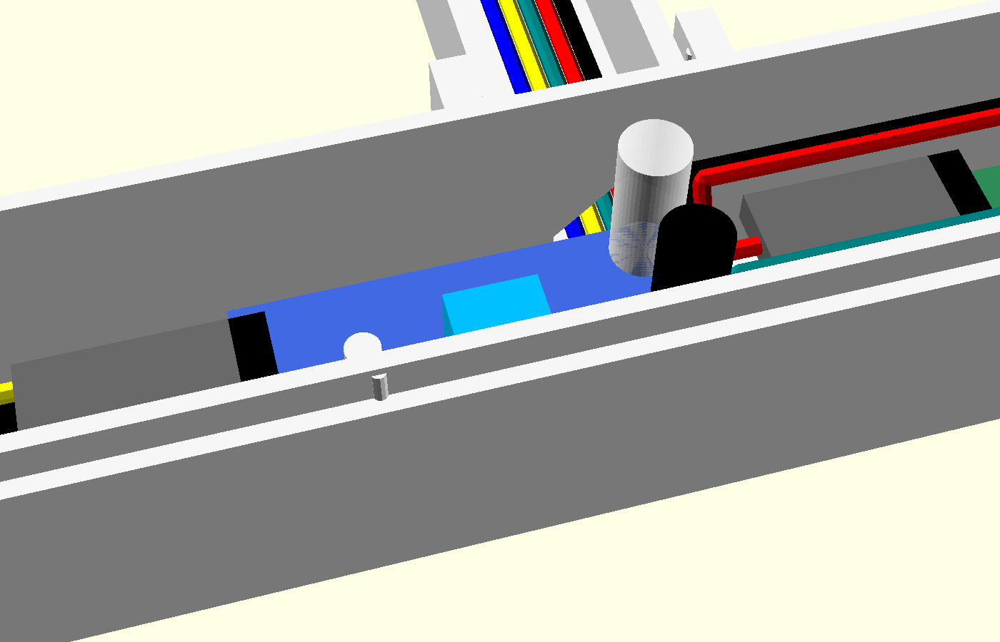
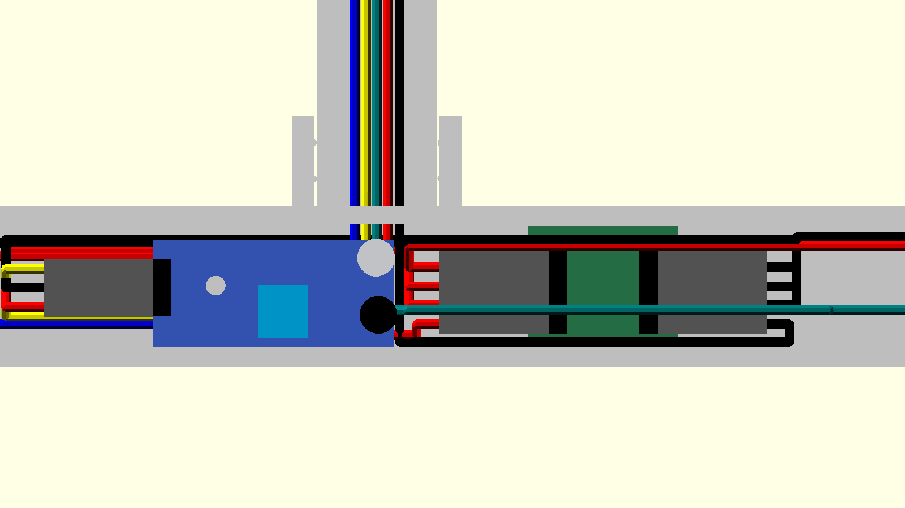
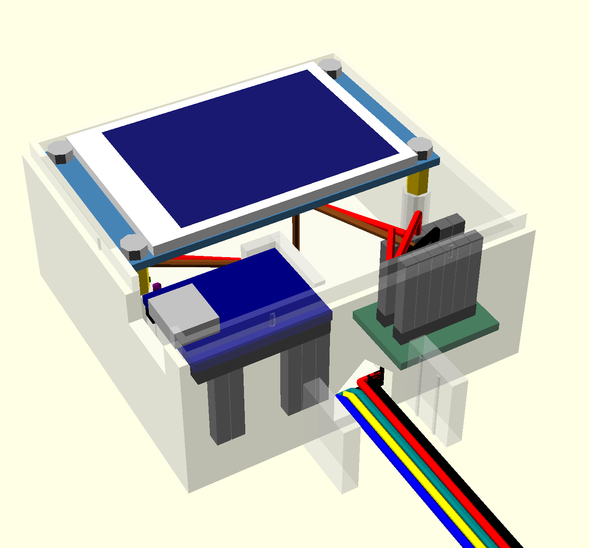
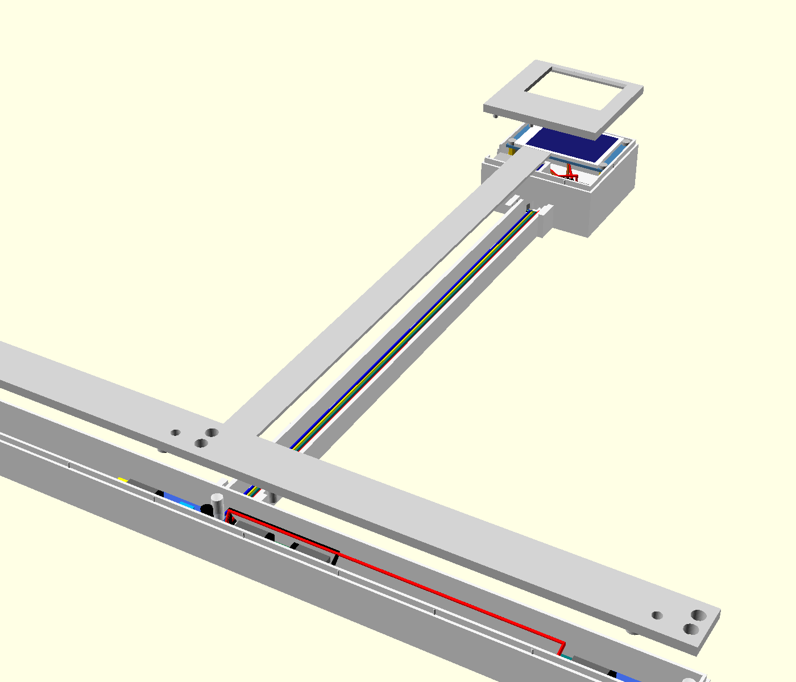
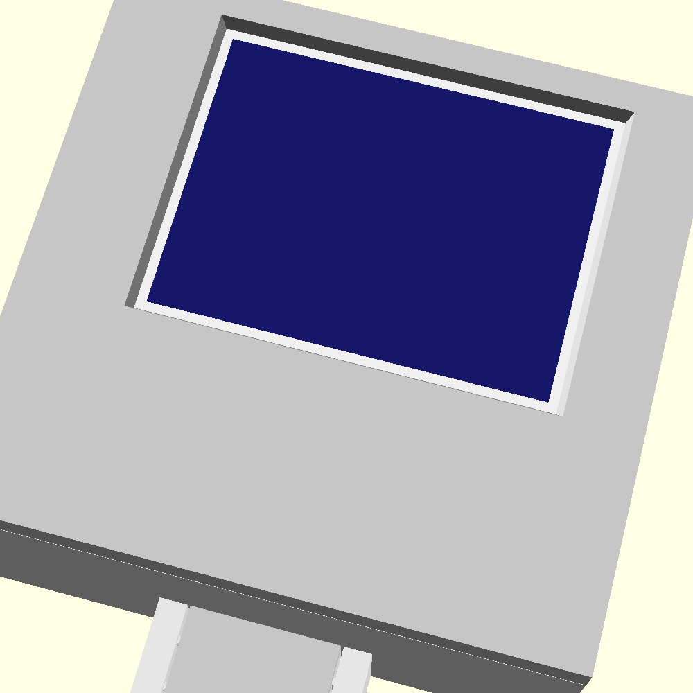

# Case v2: sensor bar, mast, and head

This is a 3D-printable case for the ESP32-S3-Zero build, written in OpenSCAD: [`coffee_case_v2.scad`](coffee_case_v2.scad). Every dimension is a variable at the top of the file. It replaces the case in [`../scad/`](../scad), which is kept as a record of the original SolidWorks design.



The case has three parts:

| Part | What it is |
|---|---|
| **Sensor bar** | About 417 × 21.4 × 24.4 mm, in 3 segments that lock together with dovetails. It holds the three FC-51 IR sensors, 203.2 mm apart, the same spacing as the old case, plus the **spider board** that splits power to them |
| **Mast** | About 16 × 13.6 mm, in 2 printed pieces. It runs from the bar up to the head and carries **5 wires** (3 sensor signals, 3V3, GND) in a channel with a snap-on strip |
| **Head** | About 63 × 61 × 32 mm. It holds the LCD, with the ESP32-S3-Zero and the Porcupine board below it. The USB-C opening faces left, toward the outlet |

## Wiring

Power is split in two places, so only 5 wires go up the mast and no lever connectors are needed. The LCD runs on 3.3 V, and nothing uses the ESP32's 5V pin.

| Board | Where | 3V3 rail | GND rail |
|---|---|---|---|
| **Porcupine board** (2 × 6 straight pins) | Head, right of the ESP32 | ESP32 3V3, LCD VCC (red), mast 3V3 (3 spare) | ESP32 GND, LCD GND (brown), mast GND (3 spare) |
| **Spider board** (2 × 5 right-angle pins, one row per rail) | Bar, right of the center sensor | Left row: mast 3V3, the 3 sensors' VCC (1 spare) | Right row: mast GND, the 3 sensors' GND (1 spare) |

| Wire | From | To |
|---|---|---|
| Sensor OUTs (blue, yellow, teal) | Medium, Dark, Decaf sensors | Up the mast to GP4, GP5, GP6 |
| Sensor VCC / GND | Each sensor | Spider board, left row / right row |
| 3V3 / GND | Porcupine board | Down the mast to the spider board |
| LCD ribbon | LCD header | GP7–12 (as in [docs/esp32-wiring.svg](../../docs/esp32-wiring.svg)), with VCC and GND to the Porcupine board |

The preview draws every wire along this route. See the wiring renders below.

**How everything is built:**
- **Bodies:** each body has a flat, solid back for the Velcro strips and is open to the front. A cover closes the front.
- **Covers:** they press on and hold by friction, using crush ribs on the body's rebate.
- **Boards:** no screws. Each board is held by a post, pocket or ledge in the body, and the cover clamps it.
- **Screen height:** `screen_h` sets the distance from the center sensor's LEDs to the bottom of the visible image. It defaults to 12.5 in (317.5 mm). Changing it only changes the mast pieces and their strips.

## Parts and printing

PLA, 0.2 mm layers. **No supports.** Every part builds straight up from the bed. The only holes through vertical walls are open-topped notches or 45° gables. This has been checked: no exported part has a downward-facing surface above the bed. Everything fits the MK4S bed; the largest part is the center bar segment at 186 mm.

| `PART` | Count | Print on | Notes |
|---|---|---|---|
| `bar_left`, `bar_center`, `bar_right` | 1 each | Back | The center segment has dovetail tabs and the mast socket |
| `bar_cover_left`, `bar_cover_center`, `bar_cover_right` | 1 each | Front face | LED bores, tuning holes, and the rings that clamp the sensor boards |
| `mast_lower`, `mast_upper` | 1 each | Back | They join with a dovetail in the back wall |
| `mast_strip_lower`, `mast_strip_upper` | 1 each | Front face | They split 30 mm above the mast joint, so they also tie the two pieces together |
| `head` | 1 | Back | |
| `head_cover` | 1 | Front face | Screen window |

Export from the command line, for example:

```bash
openscad -D 'PART="bar_center"' -o bar_center.stl case/v2/coffee_case_v2.scad
```

STLs are git-ignored; export them when you need them.

### Test prints first

These follow the office_ac_controller approach: print the parts that are easy to get wrong before the big ones.

1. **`sensor_test`:** a 50 mm piece of the center bar segment around its sensor, plus the matching piece of its cover. Check that:
   - the post's pin goes through the board's 3 mm hole, and the post doesn't sit on solder joints;
   - the LEDs enter their bores;
   - the cover presses on with friction and its ring clamps the board;
   - a screwdriver reaches the sensitivity screw through the tuning hole.
2. **`head_cover`** (small and quick): hold it over the LCD, with the LCD resting on a flat surface glass-up. Check that the window frames the lit image and that the screw-head reliefs line up.
3. **`esp_test`:** the bottom strip of the head body. Check that the ESP32 drops onto its two end supports, with the USB-C at the left wall, and that the Porcupine board snaps between its corner fences.

The spider board's holder isn't in any test piece. It sits between the bar's walls (0.25 mm to spare on each side), on four corner feet, between two end stops. The center cover has a post that presses on its empty middle.

Then print the rest.

## Assembly

1. **Sensors:** press each FC-51 onto its post, parts side out, so the pin goes through the mounting hole.
   - **The two end sensors** point their headers toward the center.
   - **The left sensor** is turned 180° from the other two.
   - Plug in the jumpers: OUT, GND, VCC.
2. **Bar:** slide the bar segments together, pressing the center segment's dovetail tabs into the end segments' notches from the front.
3. **Spider board:** set it between its stops, just right of the center sensor, 3V3 row on the left.
   - Plug each sensor's VCC into the left row and its GND into the right row.
   - Run each OUT to the center and up through the opening in the bar's top wall.
   - Plug the mast's 3V3 and GND into the spider's first pin on each side.
   - Wires can pass behind the sensor boards (a 5 mm channel) or in front of them, and over the spider board.
4. **Mast:** join the two pieces at their dovetail.
   - Seat the lower end between the cheeks on the bar's top and the upper end between the cheeks under the head.
   - Lay the 5 wires in the channel and press on the two strips.
5. **Head:** connect the wires inside:
   - Sensor OUTs to GP4–6.
   - The mast's 3V3 and GND to the Porcupine board, along with the ESP32's 3V3 and GND.
   - The LCD ribbon to GP7–12, as in [docs/esp32-wiring.svg](../../docs/esp32-wiring.svg).
6. **Boards in the head:**
   - Set the ESP32 on its supports, USB-C into the left wall's opening.
   - Press the Porcupine board between its fences.
   - Place the LCD glass-forward onto its four posts; the pins go into the standoffs.
7. **Close up:** press on the head cover, then the three bar covers.
8. **Mount:** stick Velcro to the backs of the bar segments and the head. The bar is 21.4 mm tall and `velcro_w` is 20 mm.

**Wire lengths:**
- **Each OUT:** about 35 cm from the center sensor, about 55 cm from an end sensor.
- **Sensor VCC and GND:** only to the spider board, about 5 cm from the center sensor and 20 cm from an end sensor.
- **The mast's 3V3 and GND:** about 35 cm.

## Previewing with the parts inside

The boards, LEDs, jumpers and wires are drawn only in preview (F5) when `SHOW_PARTS` is on. OpenSCAD's `$preview` is false when rendering or exporting. An export with `SHOW_PARTS` on is byte-for-byte identical to one with it off, so the boards never end up in an STL.

| `PART` | Shows |
|---|---|
| `assembly` | Everything, closed (the default) |
| `assembly_open` | No covers or strips: the boards in place |
| `exploded` | Covers and strips pulled forward (`EXPLODE` sets the distance; default 30 mm) |

| | |
|---|---|
|  |  |
|  |  |
|  |  |

## Settings worth knowing

| Variable | Default | What it does |
|---|---|---|
| `screen_h` | 317.5 (12.5 in) | Center sensor's LEDs to the bottom of the visible image |
| `velcro_w` | 20 | The bar is at least this tall |
| `hood` | 3 | How far the LED tips sit behind the front face. The bores act as hoods against side reflections |
| `clr` | 0.3 | General clearance per side |
| `cover_clr`, `rib`, `rib_pitch` | 0.1, 0.35, 20 | Cover fit: the gap between the lip and the body, how far the crush ribs stand out, and their spacing. Too tight: lower `rib`. Too loose: raise it, or lower `rib_pitch` |
| `dt_clr` | 0.15 | Dovetail clearance per side |
| `lcd_post_gap` | 0 | Raise it if the head cover won't close over the LCD |
| `win_margin` | 0.6 | Screen window margin around the lit image |
| `lcd_img_dx` | 1.7 | How far right of the PCB's center the lit image sits |
| `joint` | 87 | Where the bar segments meet (±X) |

## Measurements and how sure they are

| Item | Value | Source | Confidence |
|---|---|---|---|
| Pot spacing | 203.2 mm | The old case, confirmed by the user | High |
| FC-51 board | 32.1 × 14.1 × 1.0 mm, 2 mm of solder joints behind | Calipers | High |
| FC-51 LEDs | 5 mm; tips 11 mm above the board. Emitter [29.7, 2.3], receiver [30.0, 9.9] mm from the header end / emitter-side edge | Calipers (height, diameter); photo for position | ±0.5 mm |
| FC-51 mounting hole | 3.0 mm at [8.4, 6.0] | Calipers (size); photo for position | ±0.5 mm |
| FC-51 sensitivity screw | [17.4, 9.4] | Photo | ±0.5 mm (the tuning hole is 4 mm) |
| LCD PCB | 58 × 35 × 1.5 mm; glass and front screw heads 2 mm proud | Calipers | High |
| LCD glass | about 49 × 34.5 mm, centered | User, plus photo | ±0.5 mm |
| LCD lit image | 40.8 × 30.6 mm, centered 1.7 mm right of the PCB's center (away from the header) | Datasheet size; photo for position | ±0.7 mm. Check with the `head_cover` test print |
| LCD holes / standoffs | 2.4 and 2.75 mm in from the edges; standoffs 6 mm long | Photo; user | ±0.5 mm |
| LCD header | Straight pins pointing back, 2.3 mm from the left edge (front view) | Photo | ±0.5 mm |
| Behind the LCD, ESP32 and Porcupine board | 24 mm for header, jumpers and bend | User | High |
| ESP32-S3-Zero | 18 × 23.5 × 1.7 mm; USB-C 1 mm past the edge and 3 mm tall | Calipers | High |
| Porcupine board | about 15 × 20 mm | User | ±0.5 mm |
| Spider board | 20 × 16.1 × 1.5 mm. Right-angle pin rows 4 mm in from each end; 7 mm from the solder's bottom to the top of the pins' bend; pins 8 mm long past the bend | User | High (the 1 mm solder height is assumed) |
| Mat grid square | 7.9 mm | office_ac_controller (ruler) | High |

## Test print results

**`sensor_test`, first print (0.2 mm gap, 0.3 mm ribs every ~45 mm):**
- **Worked:** the holes line up with the LEDs and the sensitivity screw, and the post's pin holds the board.
- **Too loose:** the cover slid around. The test piece had only one rib per side because of the 45 mm spacing.
- **Fix:** `cover_clr` 0.2 → 0.1, `rib` 0.3 → 0.35 (0.25 mm interference), and a rib every 20 mm (`rib_pitch`) on every edge, including the head's ends. Reprint `sensor_test` to check.
- **Alignment:** the cover and body should line up end to end. The test piece has no lip at its cut ends, so a loose cover can slide lengthwise. The full bar's end segments have lips at their outer ends.

## Open questions for the first prints

- **Solder joints:** whether the 5 mm post under each FC-51 lands clear of the solder joints around its mounting hole. If not, lower `post_d`.
- **ESP32 USB end:** whether the support under the USB-C end hits through-hole tabs from the USB connector. If it does, shorten that support (`esp_jaw`) or lower it slightly.
- **Window position:** whether the screen window lines up with the lit image (`lcd_img_dx`, `win_margin`).
- **Cover and dovetail fit:** `rib` and `dt_clr`.
- **Standoff pins:** whether the 1.5 mm pins on the LCD posts fit the standoffs' threaded bores.
