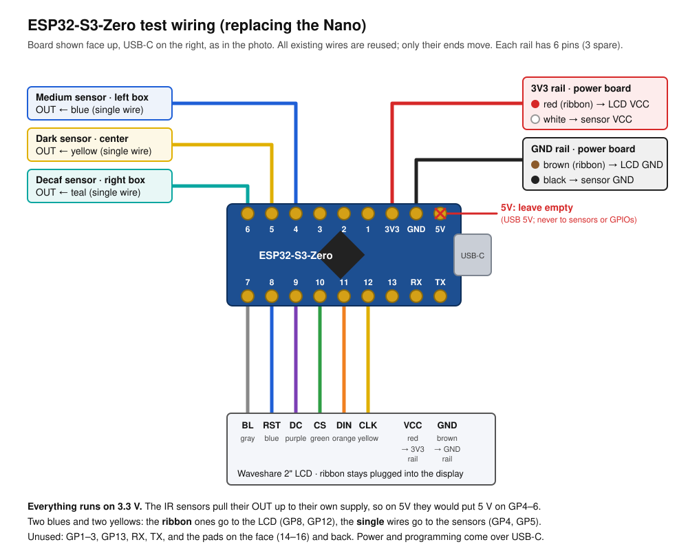

# Hardware Notes

This is everything known so far about the physical build: the parts, how they're wired and powered, and the plans for the next version. Anything not confirmed is marked *(unverified)*.

## Physical setup

- **Mounting:** the device mounts on the **wall behind the coffee pots**. The sensors face forward at the backs of the pots.
- **Three pots, left to right:** Medium, Dark, Decaf. Each pot has one sensor.
- **Current build:** everything is in one 3D-printed shell: the microcontroller, the display, and all three sensors. The wiring inside it is messy.
- **Planned redesign:** split it into two parts, joined by one cable.
  - **Sensor rod:** a slim bar holding the three sensors, hanging down to the height of the pots.
  - **Brain box:** a small box higher up on the wall with the ESP32-S3-Zero and the display.

## Display: Waveshare 2inch LCD Module

[Wiki](https://www.waveshare.com/wiki/2inch-LCD-Module)

| | |
|---|---|
| Panel | IPS, 240×320, 262K colors |
| Driver | ST7789VW |
| Interface | 4-wire SPI (write-only, no MISO) |
| Operating voltage | 3.3 V or 5 V |
| Display area | 30.60 × 40.80 mm |
| Pixel pitch | 0.0975 mm |
| Module size | 58.0 × 35.0 mm, with standoffs at the four corners |
| Connectors | 8-pin header and an 8-pin cable connector, both carrying VCC, GND, DIN, CLK, CS, DC, RST, BL |

**How the firmware drives it** (`LCD_Driver.cpp`):
- **Orientation:** landscape, 320 × 240. The init command `0x36 = 0xA0` rotates the panel.
- **Color format:** 16-bit RGB565 (`0x3A = 0x05`).
- **Color inversion:** turned on (`0x21`). IPS panels need this for colors to come out right.
- **Backlight:** dimmed with PWM, set to `80`/255 in `DEV_Config.cpp`.
- **SPI mode:** mode 3. The clock runs at 8 MHz on the Nano and 20 MHz on the ESP32-S3. The ST7789 itself can go faster than that.
- **Drawing:** the code doesn't keep a copy of the screen in memory. Every pixel is written straight to the display.

## Microcontrollers

### Arduino Nano (current)

- The board is a **RobotDyn Nano V3**, a clone with a micro-USB port.
- ATmega328P chip at 16 MHz, with 2 KB of RAM and 32 KB of flash.
- Its pins run at 5 V, but the display expects 3.3 V. This is out of spec, but it works in practice.
- Its bootloader is unknown. Clones like this often have the old Nano bootloader, but this one isn't verified. That's why the idle restart avoids a watchdog reset; see CLAUDE.md.

### Waveshare ESP32-S3-Zero (replacing the Nano)

[Wiki](https://www.waveshare.com/wiki/ESP32-S3-Zero). It's also sold as the "ESP32-S3 Mini Development Board".

- **Chip:** ESP32-S3FH4R2, a dual-core 240 MHz processor with 4 MB of flash, 2 MB of PSRAM, Wi-Fi and BLE 5.
- **Size:** 18 × 23.5 mm board, with a 1.7 mm thick PCB. It comes without headers; solder on two 9-pin male strips at the standard 2.54 mm pitch.
- **USB:** native USB-C only, with no USB-to-serial chip. To force download mode, hold **BOOT** while plugging it in.
- **Pins are 3.3 V only and not 5 V tolerant.**
- **3V3(OUT):** this pin is fed by the onboard regulator, rated for up to 800 mA.
- **5V pin:** this is the USB 5V, passed straight through. It's an output when the board runs on USB, or an input if the board is powered from it instead. **In this project nothing connects to it.** The sensors and the LCD run on 3V3, and 5V must never reach a GPIO.
- **Onboard RGB LED:** a WS2812 on GPIO21.
- **Header pins vs. solder pads:** only some GPIOs are on the edge headers. As printed on the board, viewed face up with the USB-C on the right:
  - **Top edge**, left to right: 6, 5, 4, 3, 2, 1, 3V3, GND, 5V.
  - **Bottom edge**, left to right: 7, 8, 9, 10, 11, 12, 13, RX (43), TX (44).
  - **Solder pads only:** GP14–16 on the front; GP17, 18, 38–42 and 45 on the back.
- **Avoid:** GPIO0 and GPIO3 (they affect how the chip boots), 21 (the RGB LED), and 43/44 (the serial port).

## Wiring

| Signal | Nano | ESP32-S3-Zero |
|---|---|---|
| LCD VCC | 5V | 3V3(OUT) |
| LCD GND | GND | GND |
| LCD DIN (MOSI) | D11 | GPIO11 |
| LCD CLK (SCK) | D13 | GPIO12 |
| LCD CS | D10 | GPIO10 |
| LCD DC | D7 | GPIO9 |
| LCD RST | D8 | GPIO8 |
| LCD BL | D9 (PWM) | GPIO7 |
| Medium sensor OUT | D2 | GPIO4 |
| Dark sensor OUT | D3 | GPIO5 |
| Decaf sensor OUT | D4 | GPIO6 |
| Sensor VCC | 5V | **3V3 only** |
| Sensor GND | GND | GND |

On the ESP32-S3-Zero, all of these pins are on the edge headers, so none of the solder pads are needed. The display connects along the bottom edge (GP7–12). The sensors connect along the top edge (GP4–6), which also has 3V3 and GND.

### Swapping the Nano for the ESP32-S3-Zero (test)

This test reuses every wire from the current Nano build (see the next section) and only moves their ends.
- **Display:** the ribbon stays plugged into the LCD.
- **Sensor signals:** the three single wires move to GP4–6.
- **Power:**
  - The board has only one 3V3 pin and one GND pin.
  - Each one feeds a splice connector, and everything that needs power branches off a splice.
  - The white sensor wire moves from the Nano's 5V to **3V3**.

**Steps**
1. Solder the two 9-pin headers, with the pins pointing away from the BOOT/RESET buttons.
2. Move the wires as shown in the diagram. Two colors appear twice:
   - **Ribbon blue and yellow** go to the LCD: RST on GP8 and CLK on GP12.
   - **Single blue and yellow wires** go to the sensors: GP4 and GP5.
3. Leave **5V** empty. The IR modules pull their output up to their own supply, so on 5V they would put 5 V on GP4–6.
4. Flash the firmware over USB-C with board `esp32:esp32:waveshare_esp32_s3_zero`. If no `/dev/cu.usbmodem*` port appears, hold **BOOT** while plugging in.
5. Open the serial monitor at 115200 baud. Expect `[BOOT] Starting CoffeePot Monitor...`.
6. Check the screen:
   - The title and three rows appear.
   - Pots already present show **Unknown**.
   - A lifted pot shows **Removed** after about 3 seconds.
   - A pot put back starts its timer after about 1 second.
7. If detection got worse, re-tune each sensor's sensitivity screw. They have a shorter range at 3.3 V.

Expected draw on 3V3 is roughly 100–150 mA (backlight plus three sensors), well within the regulator's rating.

## Current Nano build: wire colors

This is the wiring as it is today, read from photos of the open case (October 2026) and checked against the pin assignments in the code. Each row says how it was determined:
- **Code + photo:** the photo clearly shows the wire on that pin, and it matches the code.
- **Photo:** traced in the photos, and consistent with the code, but not certain.
- **Builder:** confirmed by the person who wired it.
- **Inferred:** worked out from what's left over. Check with a continuity tester before relying on it.

### Board and connections

- **Board:** a RobotDyn Nano V3 (ATmega328P) mounted upside down, taped inside the center body.
- **Power:** a white micro-USB cable.
- **Connections:** all wires use individual Dupont female jumper housings on the Nano's headers. Nothing is soldered.
- **Sensor power:** it's shared through two orange-lever splice connectors, WAGO-style.

### Display (8-wire rainbow ribbon)

At the LCD end, the ribbon plugs into the module's 8-pin header with a single housing. The module's white cable connector is unused. Read top to bottom at the LCD, the colors are red, brown, orange, yellow, green, purple, blue, gray. That matches the header order VCC, GND, DIN, CLK, CS, DC, RST, BL.

| LCD pin | Wire | Nano pin | Source |
|---|---|---|---|
| VCC | red | 5V (analog-side row) | Code + photo |
| GND | brown | GND (digital-side row, next to RST) | Photo |
| DIN | orange | D11 | Photo |
| CLK | yellow | D13 | Code + photo |
| CS | green | D10 | Photo |
| DC | purple | D7 | Photo |
| RST | blue | D8 | Photo |
| BL | gray | D9 | Photo |

On the Nano end, DC, RST, BL, CS and DIN occupy D7–D11 as one group of housings, in that order from left to right: purple, blue, gray, green, orange. That order matches the LCD end exactly.

### Pot sensors (single-color jumper wires)

| Nano pin | Wire | Goes to | Pot in code | Source |
|---|---|---|---|---|
| D2 | blue | Left side box (as seen from the front) | Medium (`POT1_PIN`) | Photo |
| D3 | yellow | Center body sensor | Dark (`POT2_PIN`) | Photo |
| D4 | teal / green | Right side box (as seen from the front) | Decaf (`POT3_PIN`) | Photo |

- **Photo orientation:** the photos of the inside were taken from the back, with the doors off. Left and right in them are swapped compared with the front view.
- **Pot order:** the mapping above puts the pots left to right as Medium, Dark, Decaf, which matches the order on screen.
- **Exposed pins:** the Nano's digital-row GND and D2–D4 sit next to each other as one group of four housings: brown (LCD GND), blue, yellow, teal.

### Power distribution

| From | Wire | To | Source |
|---|---|---|---|
| USB | white micro-USB cable | Nano | Photo |
| 5V (analog-side row) | red (ribbon) | LCD VCC | Code + photo |
| GND (digital-side row) | brown (ribbon) | LCD GND | Photo |
| GND (analog-side row) | black | Sensor GND, via a lever splice connector | Inferred |
| ICSP header, 5V pin | white | Sensor 5V, via a lever splice connector | Builder (wired from a Nano pinout diagram; not measured) |

- **The ICSP white wire:** the analog-side 5V pin is already used by the LCD, so the white wire takes 5V from the ICSP header's 5V pin instead. The builder wired it following a Nano pinout diagram.
- **Sensor leads:** at least one side box sensor's leads are extended with Dupont jumpers. Red and black wires leave toward that box alongside its blue signal wire.
- **Free pins:** D5, D6, D12, A0–A7, and RX/TX (D0/D1). D12 (MISO) isn't needed because the LCD is write-only.

The splice connectors make shared 5V/GND easy. A cleanup could run one 5V and one GND from the Nano to a single splice each, with every sensor and the LCD branching off. That's the same idea as the rails on the planned sensor rod (see below).

## Pot sensors: IR reflection modules *(type inferred from the code)*

These are most likely FC-51 or TCRT5000-style IR obstacle modules. Each module has:
- an IR LED and a photodiode facing forward,
- an LM393 comparator chip,
- a sensitivity screw, and
- an indicator LED.

When enough IR bounces back, the comparator pulls OUT **LOW**. The firmware treats LOW as "pot present".

- **Power:** 3.3–5 V. On the ESP32 they **must** run from 3V3. The module's output pull-up goes to its own supply voltage, so at 5 V it would put 5 V on the ESP32's pins. At 3.3 V the range is a little shorter, so re-tune the sensitivity screw.
- **Current:** about 20–30 mA each, mostly the LEDs. Three of them draw well under 100 mA.
- **Pull-up:** the module has one built in, so the pins are plain `INPUT`.
- **Reliability caveats:**
  - Readings depend on the pot's surface: glass, shiny steel and dark plastic all reflect differently.
  - They also depend on distance and angle, and on ambient IR such as sunlight.
  - A sensor tuned right at its threshold will flicker.
- **Firmware debounce:** a pot counts as placed after 1 s of steady "present", and as removed after 3 s of steady "absent". A hand passing by or a brief dropout won't reset the timer.

## Planned sensor rod wiring

The sensors only produce three on/off signals, so the rod needs **one 5-wire cable**: 3V3, GND, and the three outputs. A second microcontroller or an I2C bus isn't needed.

- **On the rod:** mount the three modules on one strip of perfboard. Run a shared 3V3 rail and a shared GND rail along it.
- **Cable:** Ethernet cable is a good fit. It has 8 wires, so 3 are spare for a fourth sensor. It's cheap, comes in any length, and RJ45 jacks on both ends make the rod detachable.
- **Length:** plain on/off signals like these are reliable over 1–2 m. The firmware debounce absorbs occasional noise.
- **Code:** nothing changes.

## Firmware behavior that depends on the hardware

- **Power-on:** a pot already on the burner at power-on shows **Unknown**. Its timer starts the next time it's put back.
- **Idle restart:** with no pot activity for 48 h (a weekend), the device restarts itself.
- **ESP32 watchdog:** the ESP32 also has a hardware watchdog that reboots it if the firmware hangs.
